# Lab: Active Directory, Sysmon and Splunk (a small SOC in VirtualBox)
 
A home lab where I built an Active Directory domain, forward its logs (Sysmon and the Windows Security log) to Splunk, and check whether I can see events such as account creation, failed logons and simulated attacker reconnaissance.
 
## Goal
 
1. Learn to manage Active Directory from PowerShell instead of only clicking through the GUI.
2. Build a log pipeline: domain controller → Universal Forwarder → Splunk.
3. See how everyday admin actions and a simulated attack look in the logs, and learn to read them.
## Architecture
 
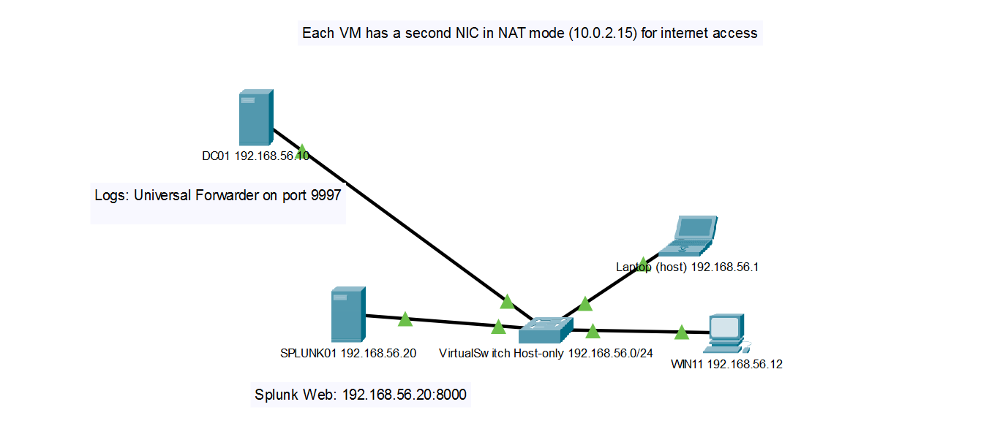
 
| Machine | OS | Address (Host-only) | Role |
|---|---|---|---|
| DC01 | Windows Server 2022 Standard Evaluation (Desktop Experience) | 192.168.56.10 | Domain controller for `lab.local`, Sysmon, Universal Forwarder |
| SPLUNK01 | Ubuntu Server 24.04 LTS | 192.168.56.20 | Splunk Enterprise (log collection and search) |
| WIN11 | Windows 11 Enterprise Evaluation | 192.168.56.12 | Domain client |
| Laptop (host) | Windows 10 | 192.168.56.1 | Splunk Web (port 8000), PuTTY |
 
**Network:**
- **Host-only 192.168.56.0/24** (DHCP disabled, static addresses): the internal lab network that connects all machines and the host laptop.
- **NAT:** a second NIC in every VM (10.0.2.15) provides internet access.
**Log flow:** DC01 → SPLUNK01, port 9997 (Universal Forwarder). Splunk Web: `http://192.168.56.20:8000`.
 
The whole lab runs on a single laptop: Windows 10, 16 GB RAM, 2 physical cores.
 
## Tools
 
| Tool | Purpose |
|---|---|
| VirtualBox | Virtual machines and the Host-only network |
| Windows Server 2022 (Evaluation) | Domain controller (AD DS, DNS) |
| PowerShell | Network configuration, AD management, installs, tests |
| Sysmon + SwiftOnSecurity config | Detailed process and network logging |
| Splunk Enterprise 10.6.1.1 | Log storage and search (SPL) |
| Splunk Universal Forwarder 10.6.1.1 | Ships logs from DC01 to Splunk |
| Atomic Red Team | Controlled simulation of an ATT&CK technique |
| Cisco Packet Tracer | Network diagram |
| PuTTY | SSH access to SPLUNK01 |
 
## What I built
 
1. **Network and machines.** A Host-only network without DHCP, three machines with static addresses and a second NAT NIC.
2. **Active Directory.** The `lab.local` domain created from PowerShell (`Install-ADDSForest`), an `LabUsers` organizational unit and several users created with `New-ADUser`. The client joined to the domain.
3. **Sysmon** on DC01 with the SwiftOnSecurity configuration.
4. **Splunk.** A server on Ubuntu Server (running as the `splunk` user), a `windows` index, and a receiver on port 9997. A Universal Forwarder on DC01 reads the `Security` and `Microsoft-Windows-Sysmon/Operational` logs.
5. **Experiments:** creating accounts, failed logons, a dashboard and a simulated reconnaissance run (Atomic Red Team, T1087.001).
The domain creation from PowerShell and the users in the `LabUsers` OU:
 
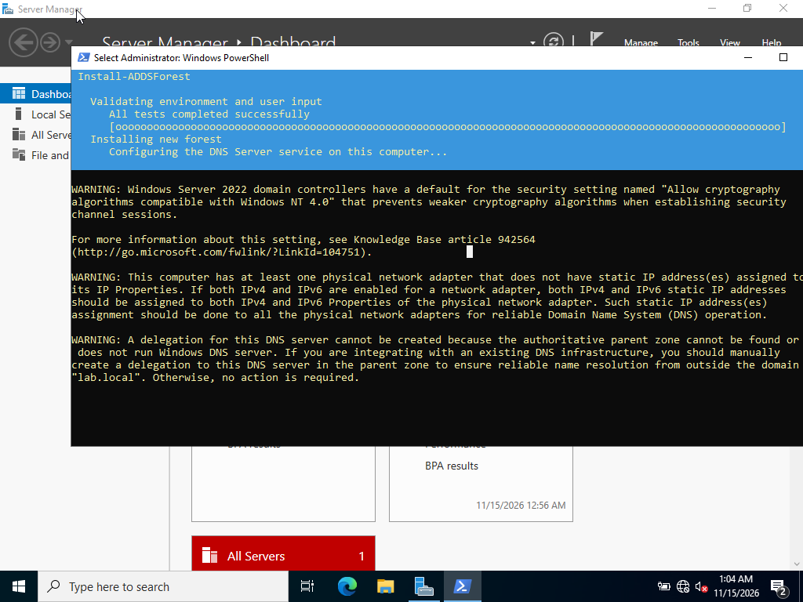
 
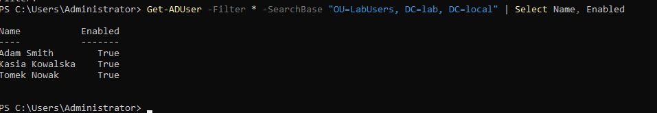
 
## Results
 
### Logs are flowing into Splunk
 
Query:
 
```
index=windows | stats count by host, source
```
 
Within one hour **1,315 events** arrived from DC01: 758 from Sysmon and 557 from the Security log.
 
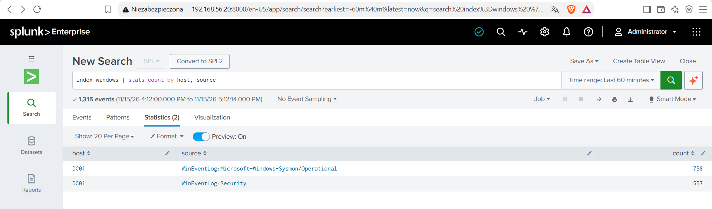
 
### Failed logons (EventCode 4625)
 
The query `index=windows EventCode=4625` shows failed logon attempts on DC01 with fields such as `Failure_Reason`, `Logon_Type` and `Account_Name`.
 
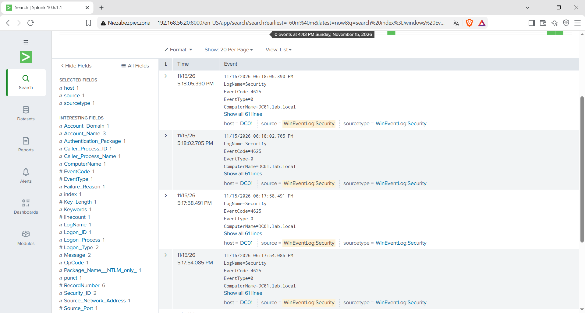
 
### One `New-ADUser` command produces five events
 
Creating a user with a single command produced five events in the Security log within about 150 milliseconds:
 
| EventCode | Meaning |
|---|---|
| 4720 | User account created |
| 4738 | User account changed |
| 4724 | Attempt to set the account password |
| 4738 | User account changed |
| 4722 | User account enabled |
 
In event 4720 the `Account_Name` field has two values: the account that performed the action (`Administrator`) and the new account. Splunk shows time in UTC, while the event text contains the Windows local time, which explains the one-hour difference.
 
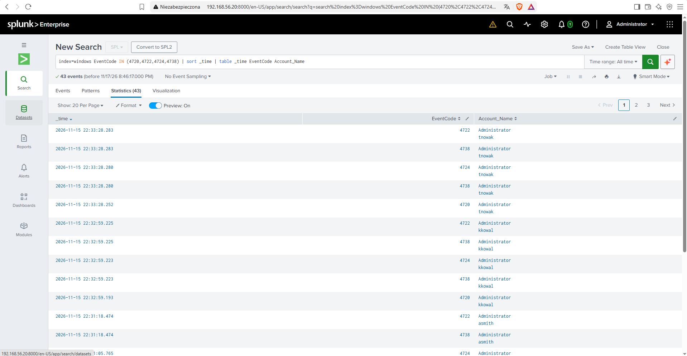
 
### "Lab AD" dashboard
 
A dashboard with three panels: failed logons over time, process creations from Sysmon by host, and new user accounts. (The panel names in the screenshot are in Polish.)
 
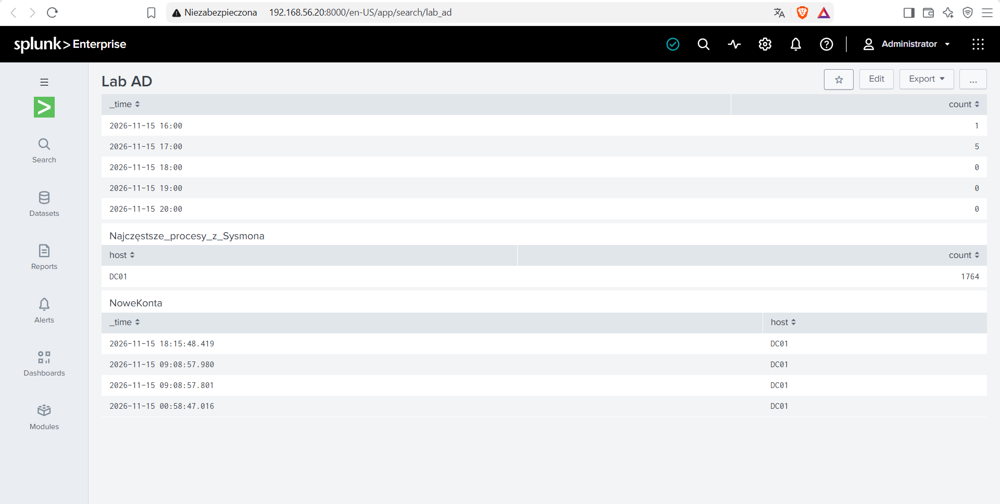
 
### Simulated reconnaissance (Atomic Red Team, T1087.001)
 
**Technique:** MITRE ATT&CK T1087.001, *Account Discovery: Local Account*. I ran test number 8 on DC01 in the lab, after taking a VM snapshot.
 
Query:
 
```
index=windows source="WinEventLog:Microsoft-Windows-Sysmon/Operational" EventCode=1 (CommandLine="*net user*" OR CommandLine="*net localgroup*" OR CommandLine="*net1*")
| table _time host User ParentImage Image CommandLine
```
 
The Sysmon logs show a single line, `cmd.exe /c net user & dir c:\Users\ & cmdkey.exe /list & net localgroup "Users" & net localgroup`, which runs several discovery commands one after another (accounts, user folders, stored credentials, local groups). Each `net` command appears as `net.exe` launching `net1.exe`.
 
**Process chain:** PowerShell (Invoke-AtomicTest) → `cmd.exe` → `net.exe` → `net1.exe`.
**Timing:** the whole sequence took about 330 ms, all as `LAB\Administrator`.
 
**Takeaway:** a single `net user` can be typed by a normal administrator. The suspicious part is the pattern: several discovery commands within a fraction of a second, launched from one `cmd.exe /c` line.
 
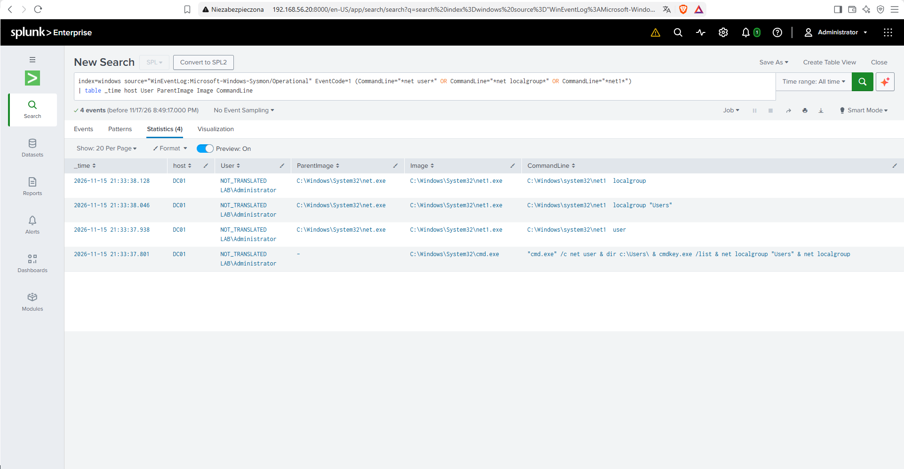
 
## How to reproduce
 
The detailed commands are in [CHEATSHEET.md](CHEATSHEET.md). In short:
 
1. Create the Host-only network 192.168.56.0/24 in VirtualBox and disable its DHCP server.
2. Install three machines (each with a NAT NIC and a Host-only NIC) and set static addresses on the Host-only NIC.
3. On DC01 install AD DS and create the `lab.local` domain, then the OU and users.
4. Install Sysmon with the SwiftOnSecurity configuration.
5. On SPLUNK01 install Splunk, create a `splunk` user and run the service as that user.
6. In Splunk create the `windows` index and enable receiving on port 9997.
7. On DC01 install the Universal Forwarder and configure `inputs.conf`.
8. Verify with `index=windows | stats count by host, source`.
There are no passwords in this repository. I enter account and service passwords at runtime (`Read-Host -AsSecureString`) and keep them in a password manager.
 
## Problems and solutions
 
| Problem | Cause | Solution |
|---|---|---|
| `Install-ADDSForest` rejected the domain name | I typed `lab-local` (with a hyphen), but an AD domain name needs at least two labels separated by a dot | Re-ran the command with `lab.local` |
| No internet on DC01 | The static address 192.168.56.10 was assigned to the NAT NIC instead of the Host-only NIC | Removed it from the NAT NIC (DHCP re-enabled), assigned it to the Host-only NIC, verified NICs by MAC address |
| `github.com` did not load on DC01 | After promotion to domain controller, the DNS server had no forwarders | `Add-DnsServerForwarder -IPAddress 1.1.1.1,8.8.8.8` |
| `New-ADUser` returned a password error, then "account already exists" | The password did not meet the domain policy, but the account was still created (disabled, no password) | `Set-ADAccountPassword -Reset` and `Enable-ADAccount` |
| Splunk would not start | Splunk 10.x refuses to start as root (deprecated) | Created a `splunk` user, gave it `/opt/splunk`, started with `sudo -u splunk` |
| Splunk web UI would not open | The browser URL used a slash (`192.168.56.20/8000`) instead of a colon | `http://192.168.56.20:8000` |
| Different time in Splunk than in the event text | Splunk displays UTC, the event text has Windows local time | Awareness of the time zone; optionally change the zone in Splunk preferences |
| Atomic Red Team: "Found 0 atomic tests" | I typed a literal `N` instead of a test number | `-ShowDetailsBrief`, then chose the Windows test number (8) |
| `find ... python3.7/site-packages: No such file` during Splunk install | The post-install script looks for an old Python directory that the new version does not use | Harmless warning, install finished correctly (`complete`) |
 
### Screenshots of the problems
 
The domain name `lab-local` rejected during promotion to domain controller:
 
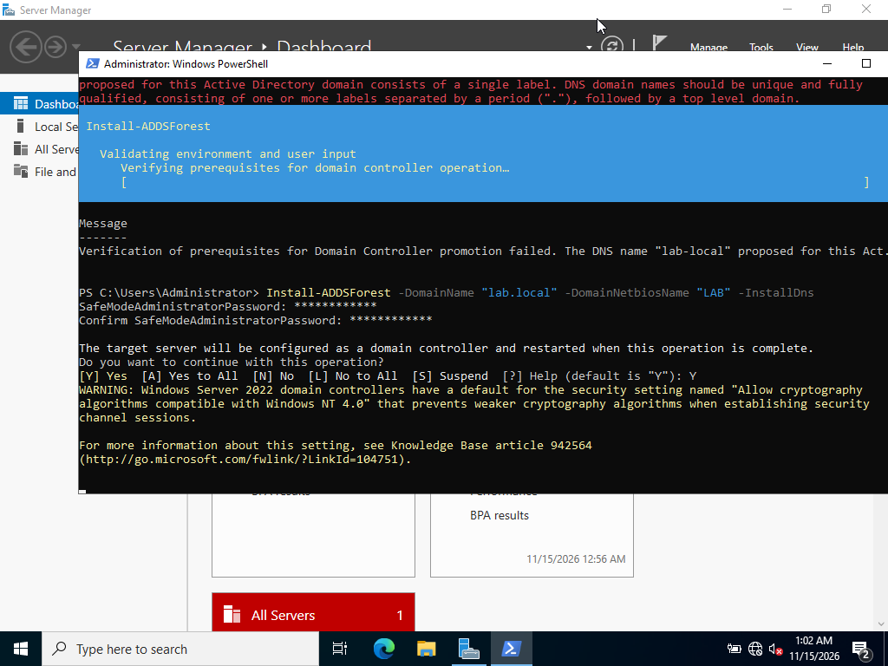
 
A password that did not meet the domain policy, followed by "account already exists":
 
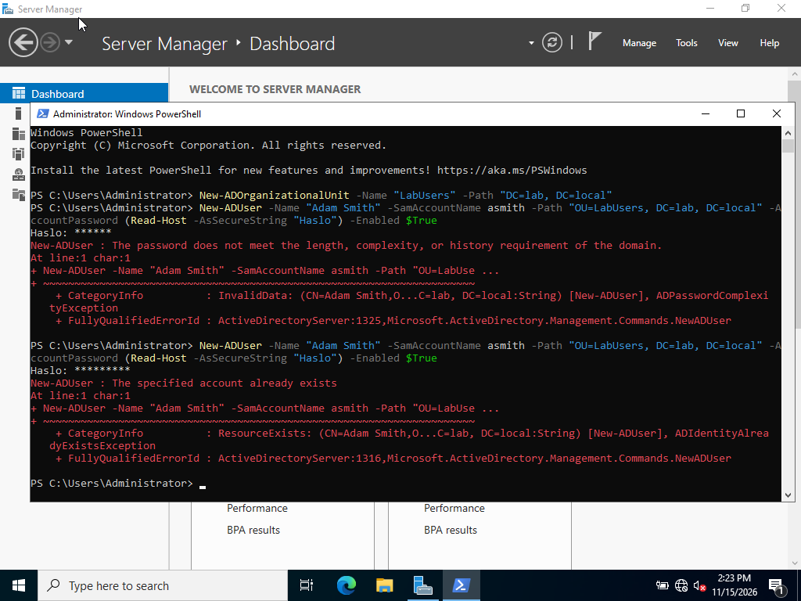
 
An address on the wrong NIC and the network adapter fix:
 
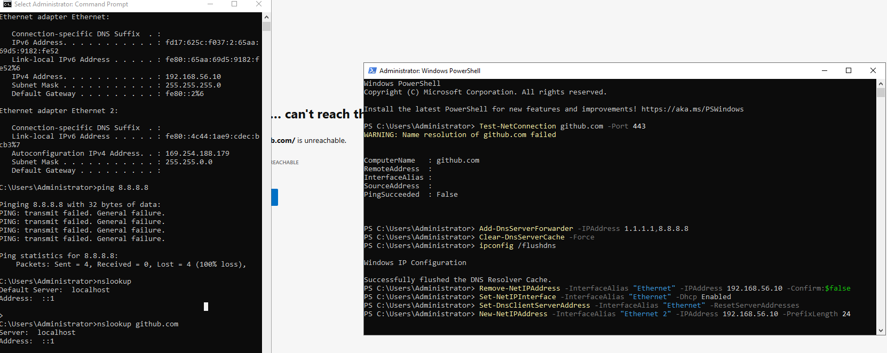
 
## Event ID reference
 
| ID | Meaning |
|---|---|
| 4624 | Successful logon |
| 4625 | Failed logon |
| 4720 | User account created |
| 4722 | User account enabled |
| 4724 | Password reset attempt |
| 4738 | User account changed |
| 4732 | Member added to a local group |
| 1102 | Audit log cleared |
| Sysmon 1 | Process creation |
| Sysmon 3 | Network connection |
| Sysmon 11 | File created |
 
## What I learned
 
- Managing AD from PowerShell (OUs, users, passwords, joining a domain).
- Building a log pipeline from source to SIEM and troubleshooting it layer by layer: network, DNS, service, index.
- Reading events: who, what, when and from which process, and following process chains in Sysmon logs.
- That a single trace is rarely enough: the pattern and the context decide whether activity is suspicious.
- Documenting problems as problem, cause, solution.
## What's next
 
- A Sigma detection rule for the pattern "several discovery commands from one `cmd.exe /c` line", tested with Atomic Red Team.
- More ATT&CK techniques and their traces in the logs.
- An investigation report on a public dataset (Splunk BOTS v3).
## Notes
 
- This is a lab environment: all addresses are private and the systems are Evaluation (trial) versions.
- I ran simulations only on my own virtual machines, after taking a snapshot.
 
